# Manual del Panel de Alta de Artículos y Compras

Última modificación: 11/10/2026.

El panel reemplaza la planilla CONTROL DE SKU. Se entra en https://pablogiacomelli.github.io/stock-dashboard/alta.html con el usuario y la contraseña del local (los mismos del panel de seguimiento de envíos). La sesión queda abierta 30 días en esa computadora. Para practicar sin tocar nada real, se puede abrir el panel con `?demo=1` al final de la dirección: muestra datos de ejemplo y no guarda.

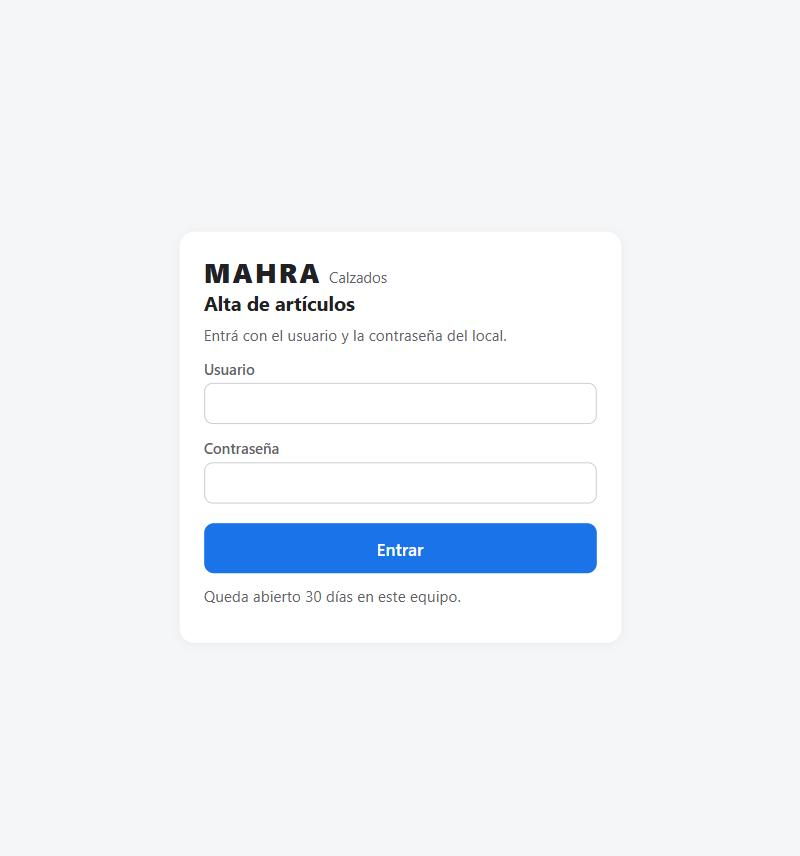

## Parte 1: dar de alta artículos nuevos

El circuito completo es: Carga rápida → Pasar a la planilla → Agregar todo a pendientes → Procesar artículos → cargar la compra → descargar etiquetas.

### 1. Carga rápida (un modelo con varios talles)

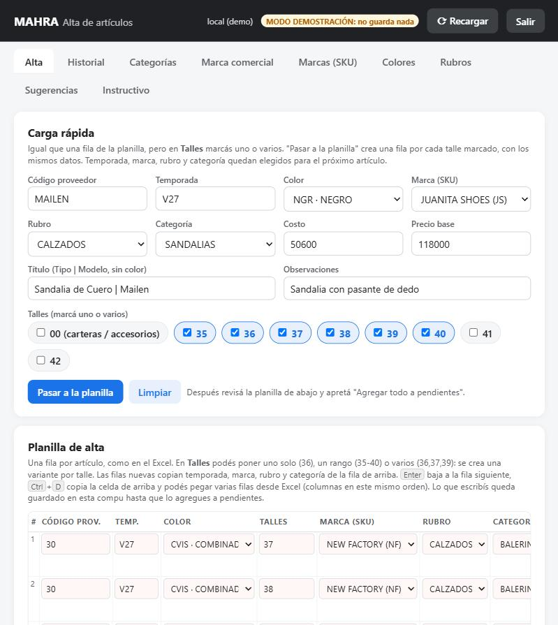

1. En la pestaña **Alta**, cuadro **Carga rápida**, completá: código de proveedor, temporada (V27, I26), color, marca (SKU), rubro, categoría, costo, precio base y título.
2. El título va como **Tipo | Modelo**, sin el color: por ejemplo `Balerina de Cuero | Siena`. El color y el talle se agregan solos en cada variante.
3. En **Talles** marcá uno o varios: 00 (carteras y accesorios), 35 a 42.
4. Apretá **Pasar a la planilla**: se crea una fila por cada talle marcado, todas con los mismos datos. Código, talles, título, costo y precio se vacían; temporada, marca, rubro y categoría quedan elegidos para el próximo artículo.
5. Si falta un dato, el panel avisa qué falta y no pasa nada.

### 2. Planilla de alta

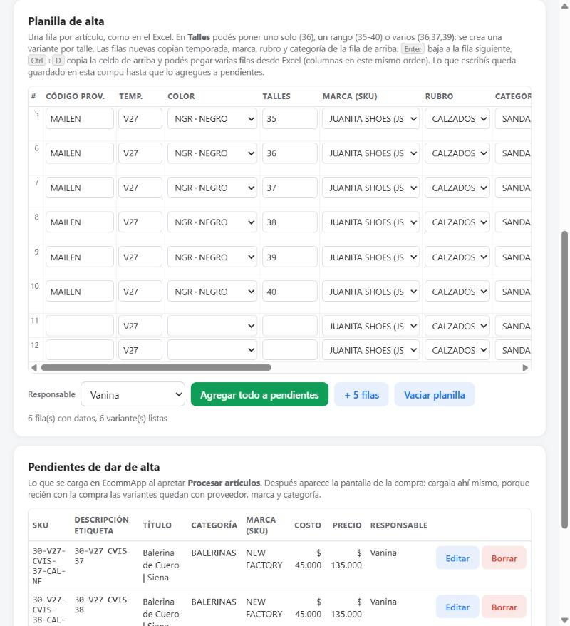

- Es una fila por variante, como en el Excel. Podés corregir cualquier celda, agregar filas (**+ 5 filas**) o quitar una fila con la ×.
- A la derecha de cada fila ves el SKU que se va a crear (`CODIGO-TEMPORADA-COLOR-TALLE-RUBRO-MARCA`) o el error en rojo: SKU que ya existe, color que no está en Colores, categoría vacía, etc.
- Teclas: Enter baja a la fila siguiente, Ctrl+D copia la celda de arriba. También se pueden pegar varias filas copiadas de Excel, con las columnas en el mismo orden.
- Lo que escribís queda guardado en esa computadora hasta que lo agregues a pendientes, aunque cierres el navegador.

### 3. Agregar a pendientes

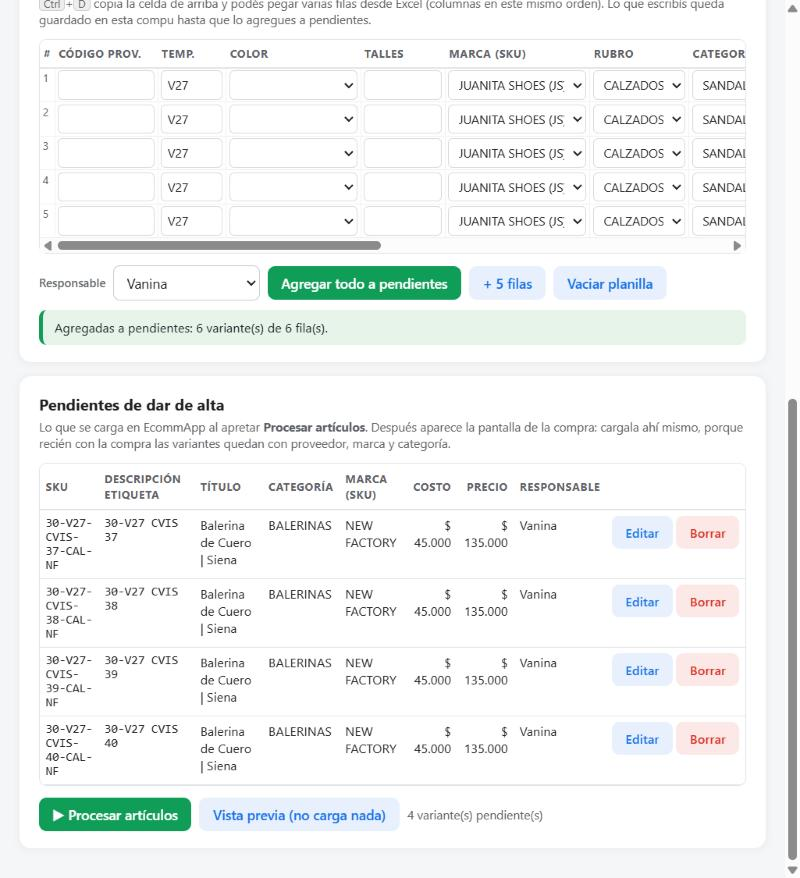

1. Elegí la **responsable** (quién está cargando) y apretá **Agregar todo a pendientes**. Las filas completas pasan a la lista **Pendientes de dar de alta**; las que tienen errores quedan en la planilla para corregir.
2. En Pendientes podés **Editar** (vuelve a la planilla como primera fila) o **Borrar** una variante.
3. Si una variante quedó sin categoría, aparece marcada: editala antes de procesar.

### 4. Procesar artículos

1. Apretá **Procesar artículos** y confirmá. Se abre otra pestaña con el resultado: las variantes creadas en EcommApp, los avisos y, debajo, el panel para cargar la compra (Parte 3).
2. **Vista previa (no carga nada)** muestra lo que se crearía sin crear nada: sirve para revisar títulos y SKU antes.
3. Las variantes nuevas nacen sin código de barras: el código lo asigna el sistema al descargar las etiquetas de la compra.
4. Al volver al panel, apretá **⟳ Recargar**: las variantes procesadas pasan al Historial como CARGADO.

### Reglas que aplica el sistema

- Si el modelo ya existe en EcommApp (mismo código de proveedor), las variantes nuevas se suman a ese producto y se respeta el nombre que tiene; si difiere del título cargado, avisa.
- Si el producto es nuevo, el título del producto es `Tipo | Modelo` y el detalle de cada variante es `Tipo | Modelo Color Talle` (por ejemplo `Balerina de Cuero | Siena Combinado Vison 37`).
- Un mismo modelo no puede traer dos temporadas distintas en la misma carga.
- Un SKU que ya figura cargado no se vuelve a crear. Si lo borraste en EcommApp y querés crearlo de nuevo, usá **Volver a pendiente** en el Historial (Parte 2).

## Parte 2: las pestañas del panel

| Pestaña | Para qué sirve | Qué se puede hacer |
| --- | --- | --- |
| Alta | Cargar artículos nuevos (Parte 1) | Carga rápida, planilla, pendientes, Procesar artículos, Vista previa |
| Historial | Ver todos los artículos del panel, cargados y pendientes | Buscar por SKU, título, marca, temporada o categoría. Botón **Volver a pendiente** en los CARGADO |
| Categorías | Categoría del artículo en EcommApp (Zapatillas, Borcegos, Sandalias, Botas y Texanas, Balerinas, Zuecos, Carteras, Accesorios, etc.) | Agregar una categoría: se crea también en EcommApp, en Categorías y marcas |
| Marca comercial | Marca con la que se vende cada artículo en EcommApp, y qué marca corresponde a cada proveedor | Elegir la marca de cada proveedor y Guardar; agregar un proveedor (se busca en la lista de EcommApp); agregar una marca comercial (se crea también en EcommApp) |
| Marcas (SKU) | La "marca" de la planilla vieja: identifica al proveedor dentro del SKU (NF, VL, SA…) | Agregar una marca con su abreviatura. La abreviatura no se puede repetir |
| Colores | Colores que se eligen al cargar | Agregar un color: Color SKU (la abreviatura, va en el SKU) y Detalle (el nombre que va en el título de la variante, por ejemplo COMBINADO VISON) |
| Rubros | CALZADOS, CARTERAS, ACCESORIOS (van en el SKU) | Agregar un rubro con su código |
| Sugerencias | Pedidos de mejora del panel o del circuito | Cargar una sugerencia con la responsable que la hace; se revisan de lunes a viernes a la mañana |
| Instructivo | Este manual | Leerlo y descargarlo en PDF; muestra la fecha de la última modificación |

### Historial: volver a pendiente

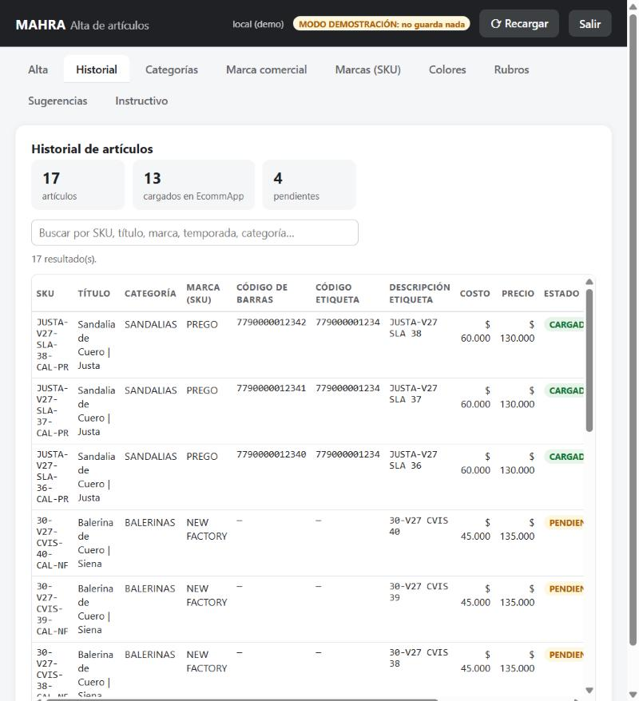

Si borraste en EcommApp un artículo que figura CARGADO (por ejemplo, uno creado sin compra), buscá el SKU en Historial y apretá **Volver a pendiente**. Vuelve a la lista de pendientes y el próximo Procesar artículos lo crea de nuevo. Si todavía existe en EcommApp, el alta lo detecta y no lo duplica.

### Marca comercial: la regla

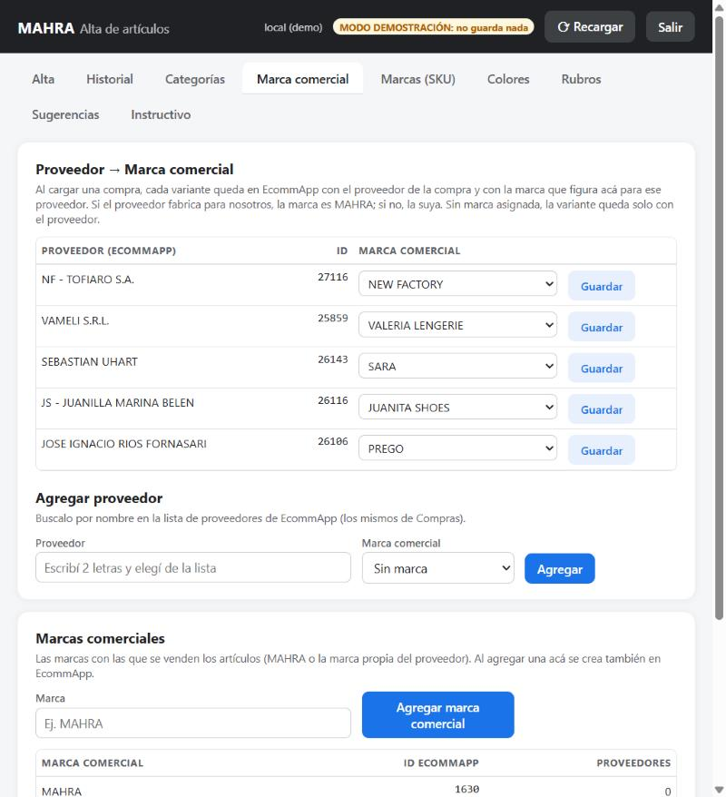

- El **proveedor** de cada variante es siempre el de la compra (se asigna al cargar la compra).
- La **marca comercial** sale de la tabla Proveedor → Marca: si el proveedor fabrica para nosotros, MAHRA; si no, su marca propia.
- La **categoría** es la que se eligió en el alta.
- Los tres datos se graban en EcommApp al cargar la compra, no al crear la variante.

### Sugerencias

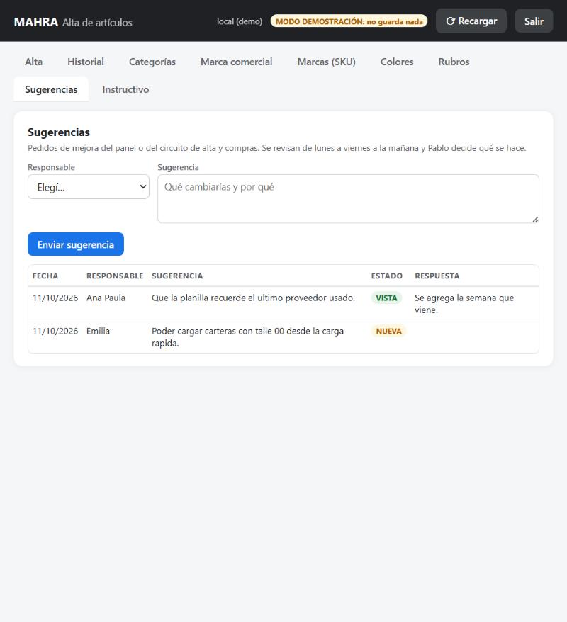

Cualquiera del equipo puede dejar una sugerencia de mejora. Se revisan de lunes a viernes a la mañana; el estado pasa a VISTA cuando fue leída y la respuesta aparece en la misma fila.

### Instructivo

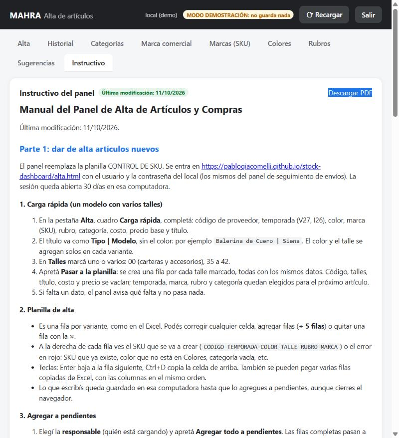

### Sesión

**⟳ Recargar** vuelve a leer todo desde el servidor. **Salir** cierra la sesión en esa computadora. Si la sesión venció (30 días), el panel pide entrar de nuevo.

## Parte 3: el panel de carga de la compra

Aparece en la pestaña de resultado que se abre al apretar **Procesar artículos**, debajo del resumen del alta, con las variantes recién creadas ya listadas. Cargar la compra ahí mismo es lo que deja cada variante con proveedor, marca comercial y categoría en EcommApp.

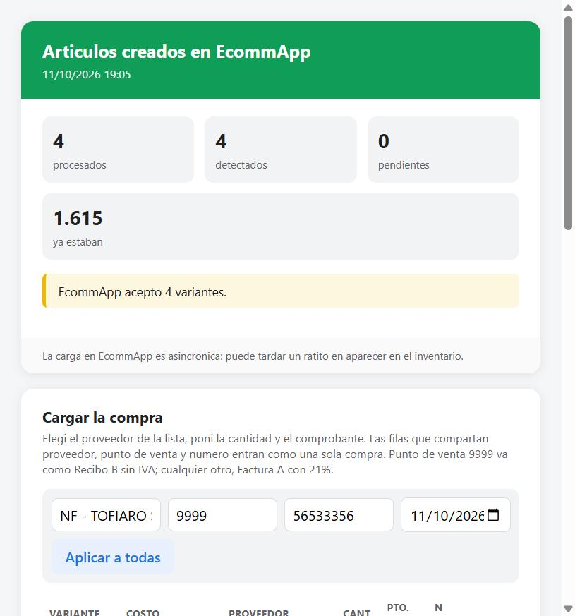

### 1. Agregar artículos que ya estaban dados de alta

Si la compra trae reposición de artículos que ya existen en EcommApp (otra temporada, un talle que se repone, un color que ya estaba):

1. En el cuadro **Agregar artículo ya existente en EcommApp**, escribí el SKU o parte (mínimo 3 caracteres, por ejemplo `30-V27` o `JACKIE`). Esperá las opciones y elegí una de la lista.
2. Apretá **Agregar**. La variante se suma a la tabla marcada como "ya existente", con el costo que tiene en EcommApp. El costo es editable.
3. Completá cantidad, proveedor, punto de venta y número igual que para las nuevas. Para quitarla, **quitar**.

También se puede cargar una compra solo de artículos existentes: Procesar artículos sin pendientes no crea nada, pero igual abre el panel de compra.

### 2. Completar la compra

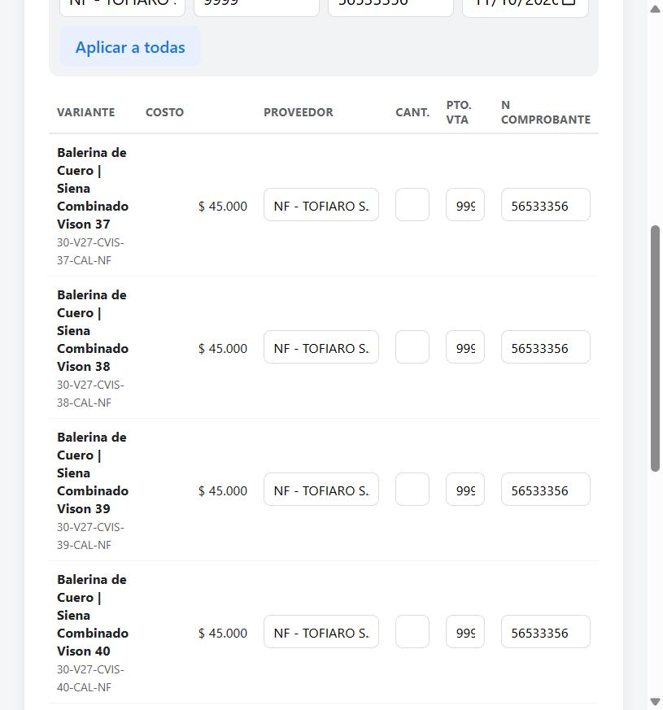

1. **Proveedor**: escribí parte del nombre y elegilo de la lista (son los proveedores de Compras de EcommApp). Tiene que elegirse de la lista; escrito a mano no vale.
2. **Cantidad**: unidades compradas por variante. Una fila con cantidad 0 no entra en la compra.
3. **Punto de venta** y **Número de comprobante**: los de la factura o recibo del proveedor. Punto de venta 9999 se carga como Recibo B sin IVA; cualquier otro, como Factura A con IVA 21%.
4. **Fecha**: por defecto la de hoy.
5. La barra **Aplicar a todas** copia proveedor, punto de venta y número a todas las filas de una vez.
6. Las filas que comparten proveedor, punto de venta y número entran como una sola compra. Si hay dos proveedores, se cargan dos compras.

### 3. Procesar compra

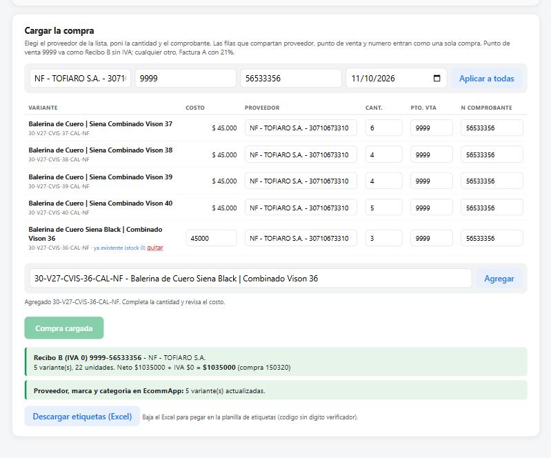

1. Apretá **Procesar compra**. El sistema carga la compra en EcommApp, con stock, en el depósito General, y muestra por cada compra: comprobante, proveedor, variantes, unidades, neto, IVA y total, con el número de compra de EcommApp.
2. Debajo aparece **Proveedor, marca y categoría en EcommApp** con cuántas variantes se actualizaron. Si dice "sin categoría" o "sin marca comercial", revisá la categoría en el panel o la marca del proveedor en Marca comercial; la compra queda cargada igual.
3. Si una compra ya estaba cargada (mismo proveedor, punto de venta y número), EcommApp la rechaza como duplicada y el panel lo avisa.

### 4. Etiquetas

1. Cuando la compra queda cargada se habilita **Descargar etiquetas (Excel)**.
2. El sistema asigna a cada variante nueva un código de barras de la serie propia 7790001 (único en todo EcommApp) y lo graba en EcommApp. Las variantes que ya tenían código conservan el suyo.
3. El Excel trae SKU VARIANTE, CODIGO PARA ETIQUETAS (12 dígitos, sin dígito verificador), DESCRIPCION ETIQUETA (por ejemplo `30-V27  CVIS 37`) y STOCK (= cantidad comprada). Se pega en la planilla de etiquetas y se imprime.

### Si algo salió mal

- Si cerraste la pestaña sin cargar la compra, las variantes quedaron creadas pero sin proveedor, marca ni categoría: cargala desde una nueva corrida de Procesar artículos agregando las variantes como "ya existentes".
- Si cargaste una variante con el color o el talle equivocado, avisá antes de imprimir etiquetas y antes de cargar la compra. Si la compra ya está cargada, hay que borrarla en EcommApp junto con las variantes equivocadas y volver a hacer el circuito.
